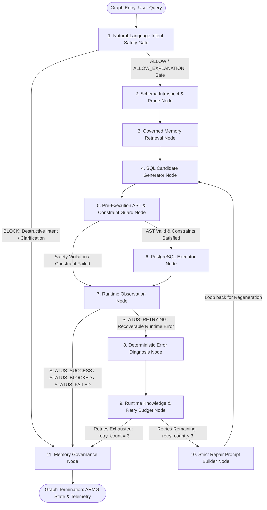

# Adaptive Runtime Memory Governance (ARMG)

[](https://www.python.org/downloads/)
[](https://www.postgresql.org/)
[](https://ollama.ai/)
[](https://github.com/facebookresearch/faiss)
[-brightgreen.svg)](tests/)

---

## 1. System Overview & Research Purpose

**Adaptive Runtime Memory Governance (ARMG)** is a closed-loop operational knowledge extraction, repair efficiency, and execution safety framework for autonomous Text-to-SQL workflows. Developed as a B.Tech Computer Science and Engineering Capstone Project at VIT-AP University, ARMG is engineered to provide an empirically grounded, technically defensible foundation for IEEE/Scopus-level research publication in software reliability, database safety, and autonomic computing.

### Core Problem Statement
Local open-weight language models (such as `qwen2.5:7b-instruct` operating with greedy decoding) frequently encounter schema misalignment, dialect-specific syntax quirks, and projection errors when translating complex natural-language analytical questions into database queries. While naive self-repair loops repeatedly call the model without structural memory, and traditional Retrieval-Augmented Generation (RAG) blindly accumulates static conversation pairs, ARMG provides:
1. **Multi-Layer Pre-Execution Safety**: Zero-token natural-language intent gating and static SQLGlot Abstract Syntax Tree (AST) validation to enforce read-only execution before queries reach the database.
2. **Explicit User-Constraint Preservation**: Deterministic extraction and projection-level verification of user-mandated table and column requirements, preventing silent semantic substitutions during self-repair.
3. **Autonomous Error Diagnosis**: Passive execution observation mapped onto a deterministic 7-tier exception taxonomy with candidate column/table resolution.
4. **Governed Operational Memory**: A mathematical control engine governing memory admission, asymptotic confidence escalation, failure penalty, continuous exponential temporal decay, and authorized quarantine using FAISS vector indexing.

---

## 2. Complete Architecture & Workflow Specification

ARMG orchestrates execution through a compiled 11-node LangGraph `StateGraph` workflow (`graph/workflow.py`). The state graph enforces strict conditional routing, bounded repair budgets ($\text{max\_retries} = 3$), and zero database invocations on safety or constraint violations.



### Detailed Node Execution Order & Edge Routing

| Node Name | Source Module | Functional Role | Conditional Routing & Graph Edges |
| :--- | :--- | :--- | :--- |
| **`intent_gate_node`** | `validation/intent_classifier.py` | Evaluates raw natural-language prompt at entry using deterministic symbolic rules before remote calls. | If decision is `BLOCK` or `AMBIGUOUS`, routes directly to `memory_governance_node` (`STATUS_BLOCKED`). Otherwise routes to `introspect_and_prune_node`. |
| **`introspect_and_prune_node`** | `agents/schema_introspector.py`, `agents/schema_pruner.py`, `validation/constraint_validator.py` | Extracts catalog schema, prunes irrelevant tables via embedding similarity, and deterministically extracts `ExplicitConstraints`. | Unconditional edge to `memory_retrieval_node`. |
| **`memory_retrieval_node`** | `memory/vector_store.py` | Retrieves top-$k$ ($k=3$) candidate memories from FAISS CPU index. Enforces retrieval threshold ($\text{sim} \ge 0.50$), lifecycle state check, and explicit constraint compatibility filtering. | Unconditional edge to `sql_generator_node`. |
| **`sql_generator_node`** | `agents/sql_generator.py`, `agents/repair_agent.py` | Generates initial candidate SQL via Ollama (`qwen2.5:7b-instruct`) or accepts optional `initial_sql_override`. In repair iterations, uses `RepairSQLGenerator`. | Unconditional edge to `ast_guard_node`. |
| **`ast_guard_node`** | `validation/execution_validator.py`, `validation/constraint_validator.py` | Performs dual static validation: (1) read-only DQL AST safety check, and (2) explicit user table and output-column projection validation. | If valid, routes to `postgres_executor_node`. If invalid, routes directly to `observation_node` (bypassing PostgreSQL). |
| **`postgres_executor_node`** | `environment/postgres.py` | Executes validated read-only SQL query against local PostgreSQL database with execution timing and error capture. | Unconditional edge to `observation_node`. |
| **`observation_node`** | `environment/observer.py` | Normalizes errors, traces execution attempts, and classifies outcome status (`STATUS_SUCCESS`, `STATUS_BLOCKED`, `STATUS_FAILED`, `STATUS_RETRYING`). | If success, blocked, or explicit constraint failed, routes to `memory_governance_node`. If recoverable failure, routes to `diagnosis_node`. |
| **`diagnosis_node`** | `agents/error_diagnosis.py` | Maps error onto 7-tier taxonomy, identifies broken identifier, extracts negative constraints, and bounds replacement candidates. | Unconditional edge to `knowledge_node`. |
| **`knowledge_node`** | `memory/knowledge_extractor.py` | Formulates immutable `RuntimeKnowledge`, tracks provenance, and increments retry counter against budget ($\text{max\_retries}=3$). | If $\text{retry\_count} \le \text{max\_retries}$, routes to `repair_prompt_node`. If retries exhausted, routes to `memory_governance_node`. |
| **`repair_prompt_node`** | `agents/repair_agent.py` | Constructs repair prompt containing the isolated `[STRICT REPAIR CONSTRAINTS]` block with forbidden identifiers and replacement rules. | Loops back to `sql_generator_node` for constrained query regeneration. |
| **`memory_governance_node`** | `memory/governance.py` | Terminal lifecycle node. Governs memory admission ($\text{Utility} \ge 0.25$), escalates confidence on success, penalizes on failure, and blocks admission for violations. | Unconditional edge to `END`. |

---

## 3. Multi-Layer Defense & Safety Architecture

ARMG implements a defense-in-depth model that separates natural-language intent gating from SQL AST parsing, explicit user constraints, database privileges, and memory governance.

```
+-----------------------------------------------------------------------------------------+
| Layer 1: Natural-Language Intent Safety Gate (Pre-Generation Classical NLP)            |
| - Fast-path keyword filter -> Ambiguity detection -> Educational/Negation whitelist    |
| - Imperative destructive command rejection (DROP, TRUNCATE, DELETE, ALTER, GRANT)       |
| - 0 Ollama Tokens | 0 SQL Generated | 0 Schema Calls | 0 Vector Store Calls | 0 DB Calls |
+-----------------------------------------------------------------------------------------+
                                          | ALLOW / ALLOW_EXPLANATION
                                          v
+-----------------------------------------------------------------------------------------+
| Layer 2: SQLGlot AST Safety Guard (Pre-Execution Static Analysis)                       |
| - Single-statement enforcement (rejects multi-statement injection ';')                |
| - Statement root inspection (requires Select or Union of Selects)                      |
| - Destructive AST node rejection (Drop, Delete, Update, Insert, Alter, Truncate, etc.) |
| - Unparsed administrative keyword rejection (GRANT, REVOKE, MERGE, EXEC)               |
+-----------------------------------------------------------------------------------------+
                                          | AST PASSED
                                          v
+-----------------------------------------------------------------------------------------+
| Layer 3: Explicit User-Constraint Validation (Projection & Relation Enforcement)      |
| - Prohibited table rejection (blocks forbidden relations before execution)              |
| - Table substitution prohibition (preserves exact requested tables in repair)           |
| - Required output-column projection verification (verifies SELECT expressions)          |
| - Wildcard projection rejection (rejects SELECT * when explicit column required)        |
+-----------------------------------------------------------------------------------------+
                                          | CONSTRAINTS SATISFIED
                                          v
+-----------------------------------------------------------------------------------------+
| Layer 4: PostgreSQL Execution Controls (Runtime Database Boundary)                     |
| - Isolated read-only connection role with bounded statement timeout                     |
| - Non-destructive execution over Star Schema warehouse                                  |
+-----------------------------------------------------------------------------------------+
                                          | EXECUTION OUTCOME
                                          v
+-----------------------------------------------------------------------------------------+
| Layer 5: Governed Memory Admission & Quarantine (Autonomic Memory Store)               |
| - Blocked requests: zero admission, zero reinforcement, terminal telemetry recorded     |
| - Constraint-violating repairs: strictly prohibited from admission or reinforcement     |
| - Authorized quarantine API: transitions invalid historical memories to ARCHIVED        |
+-----------------------------------------------------------------------------------------+
```

### Distinction: Intent Classifier vs. AST Safety Guard
An essential architectural principle of ARMG is that **natural-language intent classification** and **SQL-level AST validation** address fundamentally different threats at different points in the lifecycle:
- The **Natural-Language Intent Safety Gate** (`validation/intent_classifier.py`) acts *before* language model invocation. It evaluates the user's natural-language prompt to block overtly destructive database requests without consuming LLM inference latency or GPU compute.
- The **SQL AST Safety Guard** (`validation/execution_validator.py`) acts *after* candidate SQL generation and *before* database execution. It statically parses the generated SQL payload into an AST to guarantee that no destructive statement, stacked injection, or non-read-only expression is dispatched to PostgreSQL, regardless of whether the model hallucinated or was prompted adversarially.
- These safeguards are complementary: neither replaces the other.

---

## 4. Natural-Language Intent Safety Gate

Implemented in `validation/intent_classifier.py`, the Intent Classifier is a deterministic, rule-based symbolic classifier designed to detect destructive database commands expressed in natural language.

### Decision Pipeline & Precedence Rules
The classifier executes in a 5-step cascading decision list without invoking external libraries, neural networks, or LLM services:

1. **Step 0: Fast-Path Filtering**: Evaluates word tokens against `MUTATION_KEYWORDS` (`drop`, `delete`, `deletion`, `truncate`, `wipe`, `destroy`, `erase`, `purge`, `alter`, `kill`, `remove`). If no mutation keywords exist, it immediately returns `IntentDecision.ALLOW` with $\text{confidence} = 1.0$.
2. **Step 1: Ambiguity & Contradiction Detection**: Evaluates speculative phrasing, conflicting instructions (e.g., destructive verbs paired with analytical requests), and hesitant syntax against `AMBIGUOUS_PATTERNS`. Returns `IntentDecision.AMBIGUOUS` (`status = STATUS_BLOCKED`, `block_reason = "AMBIGUOUS_INTENT_CLARIFICATION_REQUIRED"`).
3. **Step 2: Explanation, Education, & Negation Whitelisting**: Checks for explicit negations (e.g., *"do not drop"*), educational queries (*"what is the difference between truncate and delete?"*), security audits (*"find queries that contain drop table in scripts"*), and safety questions (*"how can I prevent accidental deletion?"*). Returns `IntentDecision.ALLOW_EXPLANATION` to allow normal processing.
4. **Step 3: Destructive Command Detection**: Evaluates imperative commands requesting object destruction against `DESTRUCTIVE_EXECUTION_PATTERNS` (`DROP TABLE`, `TRUNCATE TABLE`, `DELETE FROM`, `ALTER TABLE ... DROP COLUMN`, administrative privilege alterations). Returns `IntentDecision.BLOCK` (`status = STATUS_BLOCKED`, `block_reason = "DESTRUCTIVE_INTENT_DETECTED"`).
5. **Step 4: Standalone SQL Command Detection**: Scans for embedded raw SQL commands (e.g., *"please execute: DROP TABLE fact_sales_performance"*). Returns `IntentDecision.BLOCK`.
6. **Step 5: Non-Destructive Vocabulary Default**: If mutation vocabulary appears in non-destructive idioms (e.g., *"price drop on products"*, *"remove discounts from calculation"*), returns `IntentDecision.ALLOW` with $\text{confidence} = 0.90$.

### Verified Behavior on Blocked Requests
When the Intent Gate blocks a request:
- **Ollama Invocations**: 0 calls (0 prompt tokens, 0 completion tokens).
- **SQL Generation**: Completely bypassed (no SQL candidate generated).
- **Schema Introspection**: Bypassed (0 database catalog queries).
- **Vector Store Retrieval**: Bypassed (0 candidate memories retrieved).
- **PostgreSQL Executor**: 0 calls (execution-proof guarantee).
- **State & Telemetry**: `status = "BLOCKED"`, `decision_source = "natural_language_intent_gate"`, `block_reason = "DESTRUCTIVE_INTENT_DETECTED"`, `memory_admission = "SAFETY_VIOLATION_BLOCKED"`.

### Limitations of the Intent Classifier
- The classifier is a **finite, rule-based symbolic matching system**, not a trained semantic representation model (it does NOT use BERT, RoBERTa, or neural sentence encoders).
- It relies on pre-compiled regular expressions and keyword boundaries. Unconventional paraphrasing, non-English phrasing, or novel evasion techniques outside the pattern inventory may not be caught at this gate (in which case Layer 2 SQLGlot AST validation serves as the backstop).
- It does not guarantee universal natural-language security; it provides a deterministic, zero-token pre-generation defense filter.

---

## 5. Explicit User-Constraint Preservation & Validation

Implemented in `validation/constraint_validator.py`, this component deterministically extracts and enforces explicit user constraints across initial generation, error diagnosis, self-repair, and memory admission.

### Supported Constraint Specifications
- **Exact Required Tables** (`required_tables`): User explicitly requires querying a specific relation (e.g., `fact_sales_performance_archive`).
- **Prohibited Tables** (`prohibited_tables`): User explicitly forbids referencing specific alternative tables (e.g., `fact_sales_performance`).
- **Table Substitution Policy** (`allow_table_substitution`): Deterministic boolean flag. When set to `False` (via explicit phrasing such as *"do not substitute"*, *"without substitution"*, or simultaneous required and prohibited relations), the repair agent is forbidden from replacing missing relations with existing tables.
- **Explicit Output Columns** (`required_columns`): User explicitly mandates retrieving or returning specific column values (e.g., `unmapped_metric`).

### SQL AST Projection Validation Rules
The validator inspects the parsed SQLGlot AST root:
1. **Direct Column References**: `exp.Column` in `parsed.selects` matching the required identifier.
2. **Aliased Columns & Expressions**: `exp.Alias` where either the alias name or the underlying column matches (e.g., `f.gross_revenue AS revenue`).
3. **Aggregate Expressions**: Evaluates inner column references within aggregations (e.g., `SUM(f.gross_revenue)` satisfies a requirement for `gross_revenue`).
4. **Wildcard Projection Rejection**: If the projection contains an unverified wildcard (`SELECT *`), it is strictly **rejected** because the existence of the specific column cannot be proved from the wildcard alone.
5. **Clause Isolation**: A column present in a `WHERE`, `JOIN`, or `GROUP BY` clause but omitted from the `SELECT` projection does **not** satisfy an explicit output-column constraint.

### Documented Case Studies Established by Executable Tests

#### Case A: Required Table Preservation & Substitution Prohibition
- **User Request**: *"Query the table named fact_sales_performance_archive and retrieve its gross_revenue column for every transaction. Use fact_sales_performance_archive as the exact source table name. Do not substitute fact_sales_performance..."*
- **Test Evidence**: `test_exact_original_request_workflow_rejection_of_fact_sales_performance` in `tests/unit/test_constraint_preservation.py`.
- **System Behavior**:
  1. Initial candidate SQL faithfully references `fact_sales_performance_archive`.
  2. Candidate passes constraint validation and executes in PostgreSQL.
  3. PostgreSQL returns native error: `relation "fact_sales_performance_archive" does not exist`.
  4. Diagnosis detects relation failure and checks constraints: table substitution is prohibited, so candidate replacements list is set to empty (`candidates = []`), and repair rule explicitly states: *"Table substitution is explicitly prohibited by user constraint"*.
  5. If repair proposes substituting the prohibited table `fact_sales_performance`, the Constraint Validator intercepts the repair candidate **before** a second database execution.
  6. Terminal outcome: `status = STATUS_FAILED` with `decision_source = "constraint_validator"`, `block_reason = "EXPLICIT_CONSTRAINT_VIOLATION"`.
  7. Exactly 1 database call occurs (initial attempt only; 0 calls on repair).
  8. Memory admission: `CONSTRAINT_VIOLATION_NOT_ADMITTED` (0 memories added to FAISS).

#### Case B: Required Output-Column Preservation
- **User Request**: *"Retrieve the unmapped_metric column from fact_sales_performance for every transaction. Return the value of this column directly..."*
- **Test Evidence**: `test_test4a_missing_output_column_rejected_before_database_execution` in `tests/unit/test_constraint_preservation.py` (Test 4A) and `test_live_postgres_missing_column_zero_retries_fails` in `tests/integration/test_repair_integration.py` (Test 4B).
- **Distinction Established**:
  - **Sub-case 4A (Pre-Execution Rejection)**: Candidate SQL generates `SELECT fact_key, gross_revenue FROM fact_sales_performance WHERE unmapped_metric IS NOT NULL;`. The required column `unmapped_metric` appears only in `WHERE`, not in `SELECT`. The AST validator rejects the candidate prior to execution. Outcome: 0 database calls, terminal `STATUS_FAILED`, zero memory admission.
  - **Sub-case 4B (Database Execution Rejection)**: Candidate SQL generates `SELECT unmapped_metric FROM fact_sales_performance;`. The column is present in the projection, so it passes AST constraint validation. It executes against PostgreSQL, and PostgreSQL throws a native error: `column "unmapped_metric" does not exist`. Outcome: 1 database call, terminal `STATUS_FAILED`, zero memory admission.

#### Case C: Legitimate Error Repair
- **User Request**: *"Calculate total revenue by region using the column named revenue, and group the results by region. If that column is invalid, use the database error to correct the query and return the regional revenue totals."*
- **Test Evidence**: `test_test8_regional_revenue_aggregation_repair_workflow` in `tests/unit/test_constraint_preservation.py` (Test 8).
- **System Behavior**:
  1. The user asks to calculate regional totals using a conceptual metric `revenue` and explicitly allows error correction if invalid.
  2. Initial SQL generated: `SELECT d.region, SUM(f.revenue) AS revenue FROM fact_sales_performance f ... GROUP BY d.region;`.
  3. Passes AST check (no prohibited table or immutable output column violated). Executes against PostgreSQL and fails with `column f.revenue does not exist`.
  4. Diagnoser maps failure to `TaxonomyCategory.SEMANTIC` and resolves candidate replacement `gross_revenue`.
  5. Repair SQL generated: `SELECT d.region, SUM(f.gross_revenue) AS revenue FROM fact_sales_performance f ... GROUP BY d.region;`.
  6. Repaired SQL passes AST validation and executes in PostgreSQL with success.
  7. Terminal outcome: `status = STATUS_SUCCESS`, `retry_count = 1`, 2 PostgreSQL calls. Operational memory is admitted to FAISS.
  8. **Key Rationale**: Autonomous repair is permitted and expected to correct invalid column names into valid schema attributes when doing so does not violate explicit user-mandated constraints.

---

## 6. Governed Memory & Vector Storage Engine

Implemented in `memory/governance.py`, `memory/models.py`, and `memory/vector_store.py`, ARMG's memory subsystem treats operational knowledge as an autonomic control system governed by mathematical equations.

### Mathematical Formulation of Operational Utility
Memory admission, retrieval ranking, and retention are governed by a multi-factor multiplicative heuristic:

$$\text{Utility} = \text{Confidence} \times \text{SuccessRate} \times \text{ContextSimilarity} \times \text{Recency}$$

Where:
- $\text{Confidence} \in [0.0, 1.0]$: Operational belief score.
- $\text{SuccessRate} = \frac{\text{successful\_uses}}{\text{total\_uses}} \in [0.0, 1.0]$ (assigned a neutral prior of $0.5$ when $\text{total\_uses} = 0$).
- $\text{ContextSimilarity} = \frac{1}{1 + d^2_{\text{L2}}} \in [0.0, 1.0]$: Normalized semantic similarity derived from squared L2 distance in embedding space.
- $\text{Recency} = \frac{1}{1 + \Delta t} \in [0.0, 1.0]$: Hyperbolic time discount where $\Delta t \ge 0$ represents elapsed epochs/calendar days.

### Controlled Governance Thresholds & Parameters
- $\theta_{\text{admit}} = 0.25$: Minimum utility required for candidate knowledge admission.
- $\theta_{\text{stable}} = 0.80$: Confidence threshold for promotion to `STABLE`.
- $\theta_{\text{archive}} = 0.20$: Confidence threshold below which memory transitions to `ARCHIVED`.
- $\alpha = 0.10$: Asymptotic confidence escalation rate on verified repair success:
  $$C_{\text{new}} = C_{\text{old}} + \alpha (1.0 - C_{\text{old}})$$
- $\beta = 0.15$: Proportional penalty rate upon failed repair application:
  $$C_{\text{new}} = \max\left(0.0, C_{\text{old}} (1.0 - \beta)\right)$$
- $\lambda = 0.05$: Continuous exponential temporal decay coefficient:
  $$C(t) = C_{\text{reference}} \exp\left(-\lambda \Delta t\right)$$
- $\text{Retention Period} = 30\text{ days}$: Retention horizon before `ARCHIVED` memories transition to `DELETED`.

### Memory Lifecycle State Machine
Every memory artifact exists in one of six mutually exclusive lifecycle states (`MemoryState` in `memory/models.py`):

```
       +--------+
       |  NEW   | (Initial admission, utility >= 0.25)
       +--------+
            |
            v
       +--------+       Confidence >= 0.80       +--------+
       | ACTIVE | -----------------------------> | STABLE |
       +--------+ <----------------------------- +--------+
            |         Confidence < 0.80 (Decay)       |
            |                                         |
            v                                         v
       +----------+       Confidence < 0.20      +----------+
       | DECAYING | ---------------------------> | ARCHIVED | (Quarantined / Excluded from Search)
       +----------+                              +----------+
                                                      |
                                                      | Elapsed >= 30 days
                                                      v
                                                 +----------+
                                                 | DELETED  | (Terminal physical vector deletion)
                                                 +----------+
```

### Vector Store Architecture & Session Persistence
- **Engine**: FAISS CPU (`faiss.IndexIDMap2` wrapping `faiss.IndexFlatL2(768)`).
- **Embedding Space**: 768 dimensions generated via local `nomic-embed-text` with unit L2-normalization ($||v||_2 \approx 1.0$).
- **Decoupled Architecture**: FAISS stores only 64-bit integer IDs and vector arrays. Metadata mappings (`_id_to_memory` and `_memory_id_to_int_id`) store immutable `RuntimeMemory` objects in Python memory.
- **Physical Synchronization**: Deletion removes vectors from both the FAISS index and Python metadata.
- **Persistence Scope**: The FAISS index and governance store are **in-memory per session/process**. Memory state is maintained across queries within a process or Streamlit dashboard session, but is not persisted to an on-disk relational table.

### Authorized Memory Quarantine API
The workflow exposes an explicit quarantine interface (`workflow.quarantine_memory_by_id(memory_id, reason)`):
- Transitions the specified memory artifact to `MemoryState.ARCHIVED`.
- Permanently excludes the quarantined memory from future vector retrieval searches.
- Emits structured telemetry documenting the quarantine event.

---

## 7. Streamlit Inspection Dashboard (UI)

ARMG includes a real-time observability interface built in Streamlit (`ui/dashboard.py`), runnable on `http://localhost:8501`.

### Tab 1: Live Query Execution & Runtime Trace
- **Analytical Query Selection**: Pre-configured benchmark queries or custom natural-language input.
- **Max Retries Budget Slider**: Configures repair budget ($0$ to $5$; default $3$).
- **Advanced Manual SQL Override**: Allows entering an initial SQL string directly. When populated, ARMG validates and executes this exact candidate first, bypassing initial Ollama generation.
- **Live Status Banners**:
  - `STATUS: SUCCESS` (Green) — Resolved on initial attempt (0 retries).
  - `STATUS: SUCCESS (REPAIRED)` (Green) — Resolved via autonomous repair ($1$ to $3$ retries).
  - `STATUS: BLOCKED` (Red) — Blocked by Natural-Language Intent Gate or AST Guard.
  - `STATUS: CLARIFICATION REQUIRED` (Amber) — Ambiguous intent detected.
  - `STATUS: FAILED (EXPLICIT CONSTRAINT VIOLATION)` (Red) — Constraint-violating candidate blocked before PostgreSQL.
  - `STATUS: FAILED` (Red) — Exhausted retry budget.
- **Telemetry Cards**: Status, Guard Evaluations, PostgreSQL Calls, Ollama Generations, Retry Count, Remaining Budget, Token Usage (Prompt, Completion, Total), and Stage Latencies (Intent Gate, Generation, AST Validation, PostgreSQL Execution).

### Tab 2: Governed Memory Bank Inspector
- Inspects all operational memories stored in FAISS.
- Filters by lifecycle state: `NEW`, `ACTIVE`, `STABLE`, `DECAYING`, `ARCHIVED`.
- Simulated Epoch Advance & Decay Sweep: Interactively advance simulated time to observe exponential decay and eviction.

### Tab 3: Governance Mathematics & Decay Visualizer
- Interactive visualizations of mathematical governance curves:
  - Continuous exponential confidence decay vs. elapsed epochs.
  - Asymptotic confidence escalation vs. successive successful repairs.
  - Step-down penalty reduction vs. successive repair failures.
  - 4-factor utility surface vs. context similarity and recency.

---

## 8. Verification & Test Suite

The repository contains a multi-tier automated test suite containing **489 total automated tests** (456 hermetic unit tests, 21 live integration tests, and 12 environment tests).

### Summary of Test Distribution

| Test Directory | Focus Area | External Dependencies | Test Count | Command |
| :--- | :--- | :--- | :--- | :--- |
| `tests/unit/` | Core logic, Intent Gate, Constraint Validator, AST Guard, Governance Engine, FAISS, Diagnosis, Repair Loop | Zero (Mocks external daemons) | **456** | `pytest tests/unit/ -v` |
| `tests/integration/` | Live PostgreSQL execution, live repair loop, live constraint preservation | PostgreSQL (localhost:5432) | **21** | `pytest tests/integration/ -v` |
| `tests/test_env.py` | Environment diagnostic checks (Python version, Ollama, PostgreSQL, FAISS, packages) | PostgreSQL & Ollama | **12** | `pytest tests/test_env.py -v` |
| **Total Test Suite** | **Full repository test coverage** | - | **489** | `pytest tests/ -v` |

### Key Test Suites for Recent Enhancements

1. **Natural-Language Intent Safety Gate (`tests/unit/test_phase12_intent_gate.py` — 37 tests)**:
   ```powershell
   pytest tests/unit/test_phase12_intent_gate.py -v
   ```
   - Tests all 4 intent decision categories (`BLOCK`, `ALLOW`, `ALLOW_EXPLANATION`, `AMBIGUOUS`).
   - Verifies 0 Ollama calls, 0 DB calls, and 0 repair retries on destructive requests.
   - Verifies precedence rules between manual SQL overrides and intent decisions.

2. **Explicit Constraint Preservation (`tests/unit/test_constraint_preservation.py` — 23 tests)**:
   ```powershell
   pytest tests/unit/test_constraint_preservation.py -v
   ```
   - Verifies Case A (exact table preservation & substitution blocking).
   - Verifies Case B (output-column projection verification, Test 4A & 4B).
   - Verifies Case C (legitimate error repair, Test 8 regional revenue aggregation).
   - Verifies quarantine API and memory exclusion.

3. **AST Safety Guard (`tests/unit/test_phase1d_safety_guard.py` & `test_safety_guard.py` — 25 tests)**:
   ```powershell
   pytest tests/unit/test_phase1d_safety_guard.py tests/unit/test_safety_guard.py -v
   ```
   - Verifies rejection of DDL, DML mutations, multi-statement queries, transactions, and administrative keywords.

4. **Live PostgreSQL Integration Tests (`tests/integration/test_repair_integration.py` — 5 tests)**:
   ```powershell
   pytest tests/integration/test_repair_integration.py -v
   ```
   - Verifies live database constraint preservation, missing-column failures, Test 4A projection omission, and Test 8 regional aggregation repair.

---

## 9. Installation, Setup & Quickstart

### Prerequisites
- **Operating System**: Windows 11 / Linux / macOS
- **Python**: 3.11+ (Tested on Python 3.11.9 and 3.13.2)
- **PostgreSQL**: PostgreSQL 15+ (Tested on PostgreSQL 18.1 on port 5432)
- **Ollama**: Local inference engine with `qwen2.5:7b-instruct` and `nomic-embed-text`

### Local Setup (Windows PowerShell)

```powershell
# 1. Clone or open repository
cd "c:\Users\siddu\Pictures\armg main"

# 2. Activate virtual environment
.\.venv\Scripts\activate

# 3. Install dependencies
pip install -r requirements.txt

# 4. Configure environment (.env)
Copy-Item .env.example .env
# Edit .env with your local PostgreSQL credentials

# 5. Seed Star Schema warehouse
python scripts/seed_warehouse.py

# 6. Launch Streamlit Dashboard
streamlit run ui/dashboard.py
```

---

## 10. Technical Limitations & Scope Disclosures

In accordance with academic reproducibility standards and IEEE research integrity guidelines, the following boundaries of the current implementation are explicitly disclosed:

1. **Symbolic Intent Classifier Scope**: The Natural-Language Intent Safety Gate is a rule-based regular-expression classifier. It does not employ a fine-tuned transformer or neural language model. It can fail on adversarial evasion, novel phrasing, or non-English prompts.
2. **Read-Only AST Guard Scope**: Static SQLGlot validation enforces application-level read-only checks. It should always be paired with database-level read-only role permissions (`GRANT SELECT ON ALL TABLES...`) in production environments.
3. **In-Memory Store Scope**: The FAISS vector store and governance state are maintained in process memory. They do not persist to disk across separate Python processes or server restarts.
4. **Wildcard Projections**: The Constraint Validator strictly rejects `SELECT *` queries when explicit output columns are required, as column presence cannot be verified statically from the wildcard token alone.
5. **Frozen Benchmark Baseline Provenance**: Historical benchmark results and artifacts in `benchmark/` reflect the frozen ARMG v1.0 evaluation baseline ($n=3$ multi-seed runs over 25 canonical queries). Post-v1.0 enhancements (Phase 12 Intent Gate, Phase 13 Constraint Validator) operate as documented runtime safety layers without altering the historical benchmark data.
